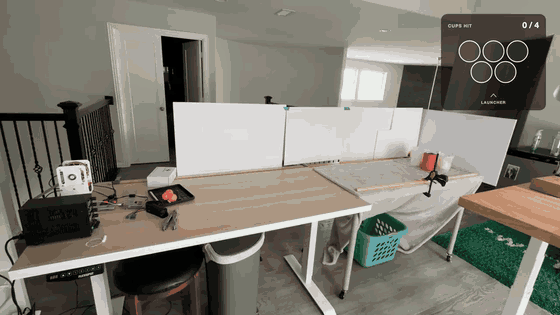
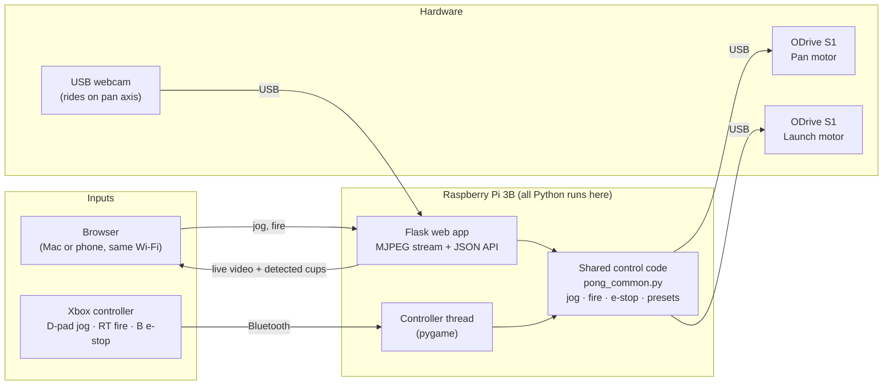
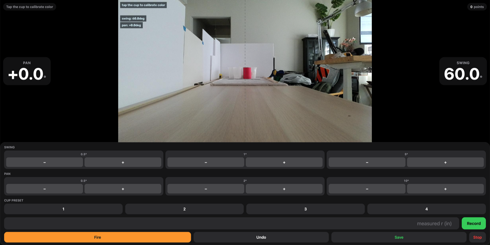
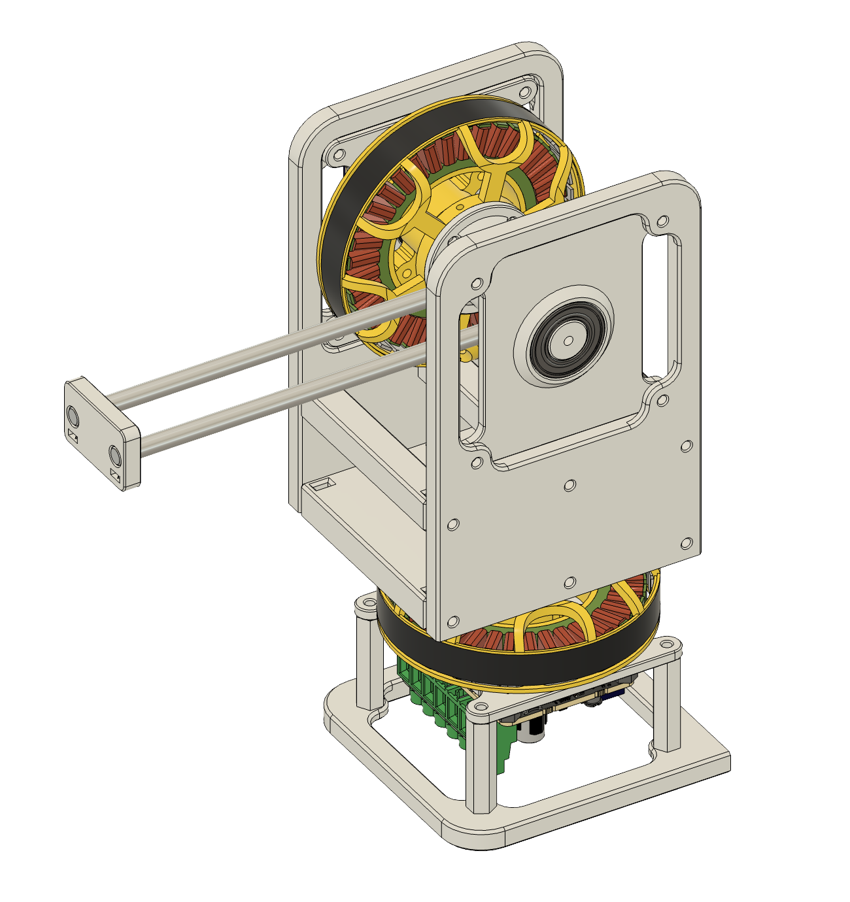
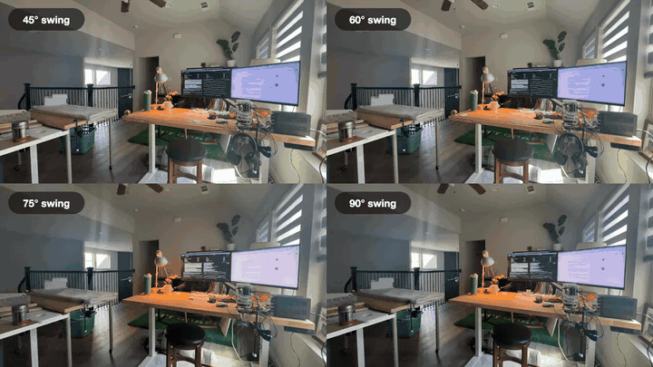
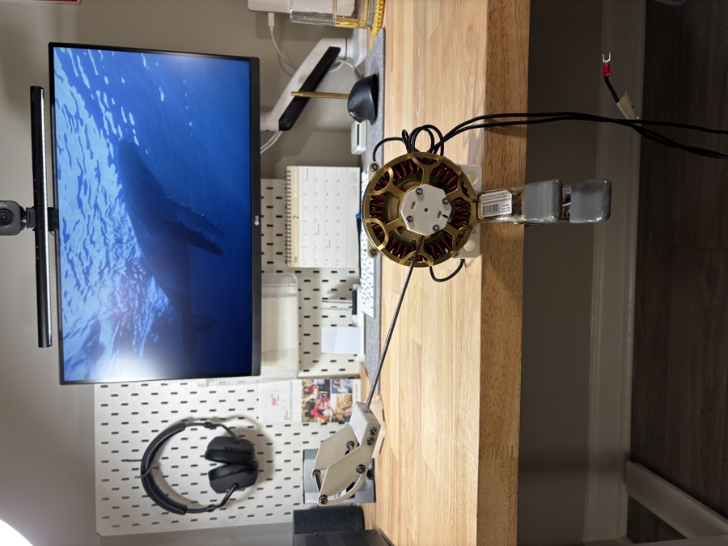
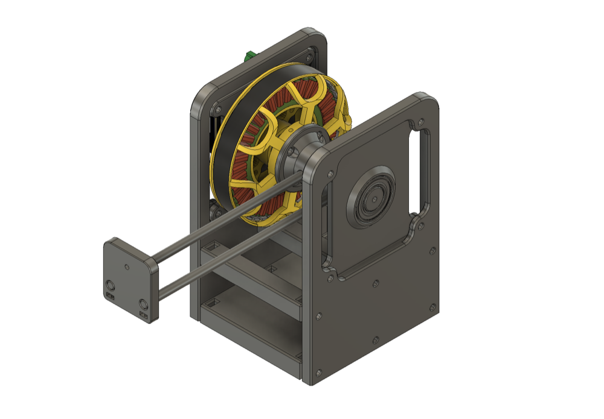
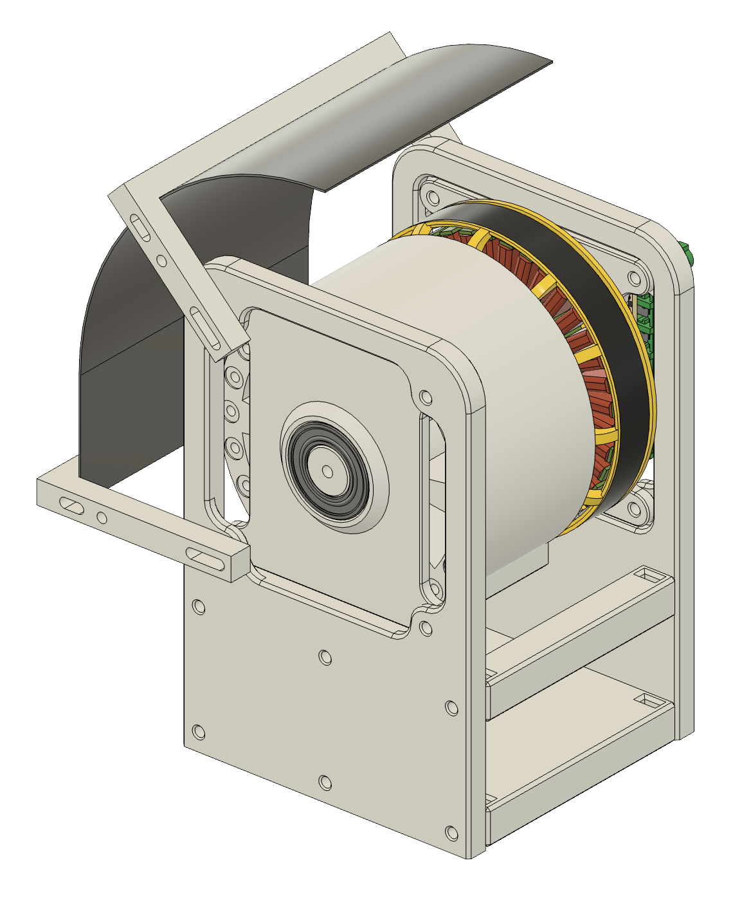

<div align="center">

# Cup Pong Robot

**A vision-guided, direct-drive BLDC catapult built to beat anyone at cup pong.**

A camera finds the cups, a pan axis lines up the shot, and an empirically calibrated launch arm sends the ball across a regulation 8 ft table. The whole system runs on a Raspberry Pi and is controlled from a browser or an Xbox controller.


**[Full project write-up with videos →](https://justinjchae.com/projects/cup-pong-robot)**



<sub>Four shots into four different cups in a row (sped up 2×). The overlay in the corner tracks cups hit.</sub>

</div>

---

## At a glance

| | |
|---|---|
| **Role** | Solo designer and builder: mechanical design, electronics, testing, and calibration. Software written with Claude Code. |
| **Timeline** | Feb 2026 to present, on and off |
| **Hardware** | 2× EaglePower LA8308 KV90 BLDC motors (direct drive) on ODrive S1 FOC controllers, USB webcam, Raspberry Pi 3B, 3D-printed and aluminum structure |
| **Software** | Python, OpenCV, Flask (MJPEG streaming + JSON API), pygame for controller input |
| **Best result** | 4 cups in a row across the table (on about 3 of every 10 attempts); ~1 inch range accuracy in calibration testing |

## Contents

- [Design requirements](#design-requirements)
- [Key design decisions](#key-design-decisions)
- [System architecture](#system-architecture)
- [Hardware](#hardware)
- [How it aims and shoots](#how-it-aims-and-shoots)
- [Engineering challenges](#engineering-challenges)
- [Evolution](#evolution)
- [Results and what's next](#results-and-whats-next)
- [Repository layout](#repository-layout)
- [Running it](#running-it)

---

## Design requirements

Before writing any aiming code, I turned "beat anyone at cup pong" into measurable targets.

| # | Requirement | Target | How it was derived | Status |
|:-:|---|---|---|:-:|
| 1 | **Range**: reach the back row of a regulation table | ~96 in from the pivot | 8 ft regulation table | ✅ |
| 2 | **Aim**: hit the intended cup, not its neighbor | ±1.12° of pan error | Touching cups are 3.75 in apart, so neighbors at 96 in sit 2.24° apart. Half of that is the budget. | ✅ pan repeats to 0.03° σ |
| 3 | **Encoder resolution**: resolve the aim budget | ≥ 322 counts/rev (9 bits) | 360° / 1.12° | ✅ measured noise 0.02° σ, ~50× margin |
| 4 | **Range accuracy**: land inside a cup mouth | within ~1.5 in | ~3 in cup mouth | ✅ ~1 in on the first rig |
| 5 | **Find cups with vision** using a single fixed-tilt camera | Real-time on a Pi 3B (no GPU) | Hardware the robot will actually run on | 🟡 detection and click-to-aim work; fully autonomous loop next |
| 6 | **Run untethered**: no laptop, controllable from any device | Pi-hosted web UI that works with no internet | The goal is to play at a bar with a phone as the controller | 🟡 Pi + web app done; battery and Pi Wi-Fi hotspot planned |
| 7 | **Hardware-safe by default** | Never drive the wrong axis or the wrong distance | All launch-axis wiring runs through the pan joint, so one bad move could tear up the rig | ✅ see below |
| 8 | **Repeatable reference positions** across power cycles | Same pan lock and arm hard stop every boot | Consistent data collection, no hand-positioning | ✅ |

**Safety requirements (#7), all implemented:**
- Every script connects to each ODrive **by serial number**, never "whichever controller answers first"
- The pan axis is confined to a **±45° window** around its locked center
- An **e-stop** (keyboard, web UI, or controller B button) works even in the middle of a move
- Any USB transport error is **treated as an e-stop**: both axes disarm instead of retrying a dead connection
- Startup corrections that look implausibly large **abort** instead of moving

## Key design decisions

| Decision | Why |
|---|---|
| **Direct-drive BLDC motors with FOC controllers** (no gearing) | Reused ODrive hardware from my [wheeled biped thesis](https://justinjchae.com/projects/wheeled-biped). The onboard absolute encoders make position-setpoint control of the arm simple, and direct drive avoids backlash. |
| **Single control input per shot: the arm's stop angle** | One stop angle gives one trajectory, so targeting reduces to finding the stop angle whose arc passes through the cup. |
| **Cylindrical target coordinates (θ, r, z)** centered on the pan pivot | The camera only rotates about a vertical axis, so a cup's pixel row depends only on its distance. That is what makes reading range from one camera workable. |
| **Empirical launch calibration instead of a geometric model** | Slow-motion video showed the ball doesn't release at a fixed point relative to the arm's stop, so I measured exit speed and angle directly. |
| **Classical color detection instead of a trained detector** | A neural detector would likely bog down a Pi 3B with no GPU. Click once on a cup to sample its color, then filter matches by minimum size. |
| **Range from the pixel row of the cup's *base*, not its center** | A point on the table maps to a row that depends only on distance. The center of the cup also depends on cup height and viewing angle. |
| **Reuse a measured pixel→angle curve** instead of estimating it live | Live estimates from noisy detections swung from −6,267 to +3,600 px/turn. The calibrated curve converges in one move. |
| **Browser UI hosted on the Pi** instead of SSH/X11 window forwarding | X11 had 1.5 to 2 s of lag that resolution changes couldn't fix. Compressed MJPEG over HTTP is fast and works from any phone. |
| **Calibrate first, fix arm stiffness later** | Early tests showed ~2.1° of side-to-side scatter. I collected real data anyway to find where the approach actually broke, since recalibration after an arm change was a bounded cost. |

## System architecture



The browser and the controller are just two ways into the **same control functions**, so I can jog from either one interchangeably.

<p align="center">
  
  <br><sub>The web app in range-calibration mode: live camera feed, pan and swing readouts, jog step sizes, and four saved cup presets.</sub>
</p>

## Hardware

<table>
<tr>
<td width="55%" valign="top">

Two direct-drive axes, each an **EaglePower LA8308 KV90** motor on its own **ODrive S1**:

- **Pan**: rotates the whole launcher left and right. The webcam is mounted on this axis, so it turns with the launcher (no tilt).
- **Launch**: a catapult arm bolted directly to the rotor, mounted on top of the pan motor. The arm swings from a start position to a commanded stop angle, and the ball flies off the end.

**Current arm (v3):** two parallel ¼" aluminum rails joined by a 3D-printed end piece, 180 mm from the pivot to the ball. The ball touches three points (both rails and one point on the end piece) for a consistent release. The pivot sits 236 mm above the table.

**Controller hardware:** Raspberry Pi 3B. Its 4 USB ports cover both ODrives and the webcam with one to spare.

</td>
<td width="45%" valign="top">

<br><sub>Launch mechanism v3: pan motor at the base, launch motor on top, twin aluminum-rail arm.</sub>
</td>
</tr>
</table>

## How it aims and shoots

The pipeline is: **find the cup → pan to center it → read its distance from the image → choose the matching stop angle → fire.** That split the work into two independent calibration tracks.

### 1. Launch calibration (stop angle → range)

I measured each reference shot directly. A soft blanket on the landing table leaves an imprint where the ball hits, measured with a tape measure, and **240 fps slow motion** gave the flight time, counted frame by frame. With distance *r*, time *t*, and release height, the exit velocity comes out with no assumption about launch angle:

$$v_x = \frac{r}{t} \qquad 0 = h_{\text{release}} + v_y\,t - \tfrac{1}{2}g\,t^2$$

<table>
<tr>
<td width="50%" valign="top">

| Swing angle | Exit speed | Launch angle |
|:-:|:-:|:-:|
| 45° | 2.14 m/s | 69.2° |
| 60° | 2.83 m/s | 44.7° |
| 75° | 3.84 m/s | 35.1° |
| 90° | 4.88 m/s | 26.0° |

I fit a smooth curve through these four shots. A range-test script takes a requested distance, solves for the swing angle, and fires. Shots landed **within about 1 inch** of the requested distance.

</td>
<td width="50%" valign="top">

<br><sub>The four reference shots in 240 fps slow motion, aligned at release.</sub>
</td>
</tr>
</table>

After the arm was rebuilt (which invalidates any launch calibration), I switched to a faster method: place a cup at a set distance, adjust the swing angle in 0.5° / 1° / 5° steps until the ball goes in, and log that angle (`web_range_calibration.py`).

### 2. Vision aiming (pixels → pan angle and range)

- **Detection:** click once on a cup in the live feed. The script samples that color and boxes every match larger than a minimum size, so small specks are ignored.
- **Range:** read from the pixel row where the cup meets the table, using a curve built by placing a cup at tape-measured distances (`cup_pixel_calibration.py`).
- **Pan angle:** read from the cup's horizontal offset in the image, using a curve built by an automatic pan sweep across a fixed target (`theta_calibration.py`).
- **Bias corrections:** comparing landings against targets exposed two constant offsets (shots ~1.5 in long, and the camera center not lining up with the ball's actual direction), both corrected in software.

## Engineering challenges

<details open>
<summary><b>Holding a position across power cycles</b></summary>

- **Problem:** The ODrive's position estimate re-zeroes on every boot, so saved positions (pan lock, arm hard stop) pointed somewhere else after a power cycle.
- **Fix:** The S1's onboard encoder is a true absolute magnetic sensor. I anchor every reference position to its raw reading (0 to 1 per turn). On startup, each script computes the shortest wrapped correction and drives there, aborting if the correction is implausibly large. Nothing needs to be positioned by hand anymore.
</details>

<details>
<summary><b>Stiff, non-oscillating holds (cascaded loop tuning)</b></summary>

Each symptom pointed at a different gain in the cascaded position/velocity loop, so I changed one at a time:

| Symptom | Change |
|---|---|
| Locked axis felt "gummy" and was knocked off position by each launch | Raised position gain 20 → 40, with more velocity-limit headroom so a hard push wouldn't trip a fault |
| Slow hunting around the target | Raised velocity gain to 0.35 and lowered integrator gain to ~0.12 to 0.20 for more damping |
| Overshoot, then slow creep back | Raised position gain further instead of changing the damping terms |
</details>

<details>
<summary><b>Aiming that wouldn't converge</b></summary>

- **Problem:** The original tracker corrected on every frame and oscillated, because the camera rides on the axis it is correcting. A look-move-recheck approach estimated px/turn live, but noisy detections made that estimate swing from −6,267 to +3,600, and aims wandered for 6 to 8 moves.
- **Fix:** Reused the pixel-to-angle curve from the one-time calibration sweep, so most aims converge in **one move**. Tracked the selected cup by its own last position so a passing hand can't take over the aim. On the Pi, discarding one buffered (stale) camera frame before each read eliminated overshoot.
</details>

<details>
<summary><b>Display lag and USB brownouts on the Pi</b></summary>

- **Problem:** The SSH/X11 aiming window lagged 1.5 to 2 s. Halving the resolution barely helped, so the bottleneck was the protocol, not bandwidth. Later, both ODrives began throwing transport errors mid-session.
- **Fix:** Replaced X11 with the Pi-hosted web app. The system log showed **undervoltage warnings** that lined up exactly with the transport errors: the camera, both ODrives, and a wireless keyboard receiver were overloading the Pi's shared USB power. Removing the receiver (which the web app made unnecessary) stopped the brownouts, and transport errors now trigger an e-stop.
</details>

<details>
<summary><b>Chasing shot scatter: ruling out every suspect</b></summary>

Even on the rebuilt rig, shots at identical settings landed 2.25 to 4 in apart side to side. I measured each possible cause directly with the encoders and motor telemetry:

| Suspect | Test | Result |
|---|---|---|
| Pan holding position | 20 repeated pan moves | 0.03° σ (0.03 in at 5 ft) |
| Launch recoil knocking the pan axis | Pan encoder before/after 10 shots | 0.09° σ per shot |
| Ball drop disturbing the resting arm | 5 drops onto the arm | Settles back within 0.11° |
| Launch motion itself | 20 logged shots | 0.6% peak-velocity variation; 0.11° peak position |

**Conclusion:** Everything up to the moment of release repeats to about 0.1°, which accounts for well under an inch at the table. The scatter comes from the release itself and the very light ball. A gentler deceleration profile, a physical hard stop, and both stiffer and softer gains did not clearly help. I then narrowed scope to making the 7 to 8 ft range solid for the first demo.
</details>

## Evolution

| V1: proof of concept | V2: rigid housing | V3: pan axis + aluminum arm |
|:-:|:-:|:-:|
|  |  |  |
| 3D-printed base, a steel chopstick arm, and a cardboard ball holder (later a printed holder with adjustable contact points). Showed the motors were fast enough. | Proper motor housing with bearing support for the arm. Hit 4 of 5 shots from 10 ft. | Added the pan axis and webcam, then rebuilt the arm with aluminum rails and a 3-point ball rest to reduce side-to-side scatter. |

<table>
<tr>
<td width="65%" valign="top">

**Flywheel prototype (v3b):** Since the scatter looks inherent to the catapult, I also tried a 91 mm flywheel on the same launch motor, with a curved hood that sets a fixed launch angle, so wheel speed alone controls range. So far it wobbles and reaches only ~30 in, so the catapult remains the main launcher.

</td>
<td width="35%" valign="top">

</td>
</tr>
</table>

## Results and what's next

**Results so far**
- **Four shots into four different cups in a row**, cycling through saved cup positions with the Xbox controller (about 3 of every 10 attempts)
- The calibrated launch model landed **within ~1 in** of the requested range on the first rig
- Pan position, arm position, and launch velocity all repeat to **~0.1°** up to release

**Next steps**
- **Close the vision loop on the rebuilt rig.** The red cup's reflection stretches its detected box past the bottom of the cup, so range will be read from the top of the cup instead.
- **Autonomous play.** Made cups get pulled off the table, so the robot can re-scan before every shot, aim at the nearest remaining cup, and fire.
- **Portability.** A 20 V DeWalt battery powering the ODrives directly, a 5 V converter for the Pi, and the Pi hosting its own Wi-Fi network.
- **Real-table geometry.** Raise the camera (and likely the launcher) to see over the robot's own cups at the table edge.

## Repository layout

```
pong_common.py                Shared hardware + vision library: serial-locked ODrive connects,
                              raw-encoder anchoring, watchdog feeding, cup detection, calibration lookups

── Main apps ──────────────────────────────────────────────────────────────────────────────────
web_click_to_shoot.py         Browser "targeting HUD": live MJPEG feed, click a cup to aim, fire;
                              semi-auto and manual modes
web_range_calibration.py      Browser launch calibration: jog the swing until the ball lands, log (r, angle);
                              Xbox controller support
web_cup_pixel_calibration.py  Browser pixel-row → range calibration capture
click_to_shoot.py             Original OpenCV-window version of click-to-shoot
range_test.py                 Enter a tape-measured distance; solves for the swing angle and fires
combined_control.py           Pan + launch control with auto-lock to saved positions

── Calibration ────────────────────────────────────────────────────────────────────────────────
cup_pixel_calibration.py      Pixel row of cup base → distance curve
theta_calibration.py          Pixel offset → pan angle curve, via automatic sweep
cup_map.py                    Maps (θ, r) of every same-colored cup on the table
pan_encoder_calibration.py    One-time pan motor commutation calibration
*.json                        Saved calibration curves and cup map (read by pong_common.py)

── Characterization tests ─────────────────────────────────────────────────────────────────────
pan_repeatability_test.py     20 pan moves to the same target; logs raw encoder spread
pan_shock_test.py             Does launch recoil shift the pan axis?
launch_ball_drop_settle_test.py  Does dropping the ball on the arm disturb its start position?
fire_telemetry_logger.py      Logs position/velocity/current through every launch stroke
hardstop_decel_test.py        Physical hard stop vs. software deceleration profile
anchored_fire_visualizer.py   Web viewer for logged shot telemetry
ball_weight_current_test.py   Can motor current detect whether a ball is loaded?
flywheel_velocity_test.py     Flywheel launcher characterization

── Utilities ──────────────────────────────────────────────────────────────────────────────────
pan_axis_test.py, launch_arm_control.py   Single-axis jog tools
pan_read_position.py, launch_read_position.py   Read-only encoder monitors (no motion)
lock_pan_only.py              Headless pan lock-and-hold
xbox_controller_test.py       Controller button/axis mapping diagnostic

data/                         Launch telemetry CSVs and per-shot JSON logs from characterization runs
docs/media/                   Images and GIFs used in this README
legacy/                       Early prototype scripts (pre-safety-rework; kept for reference, not for running)
```

## Running it

> ⚠️ These scripts move real motors. Each one is tied to the specific ODrive serial numbers, encoder offsets, and calibration data of this rig, so treat the code as a reference rather than a drop-in package.

```bash
python3 -m venv odrive_env
odrive_env/bin/pip install -r requirements.txt

# Main web interface; then open http://<pi-ip>:5000 from any device on the network
odrive_env/bin/python web_click_to_shoot.py
```

---

<div align="center">
<sub>Built by <a href="https://justinjchae.com">Justin Chae</a> · <a href="https://justinjchae.com/projects/cup-pong-robot">Full write-up</a></sub>
</div>
